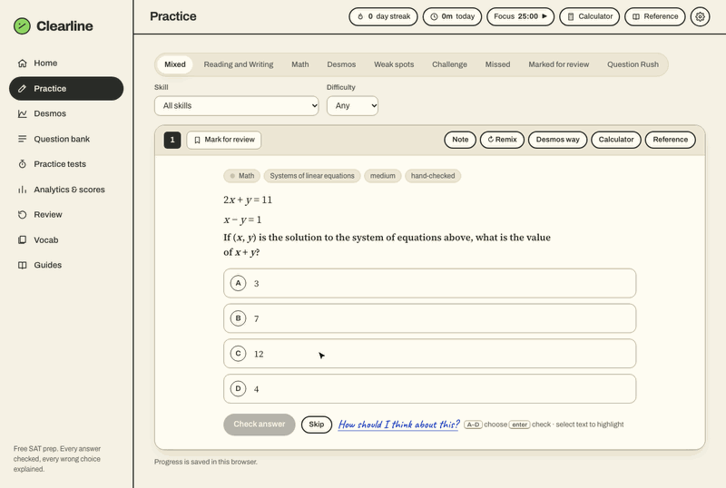
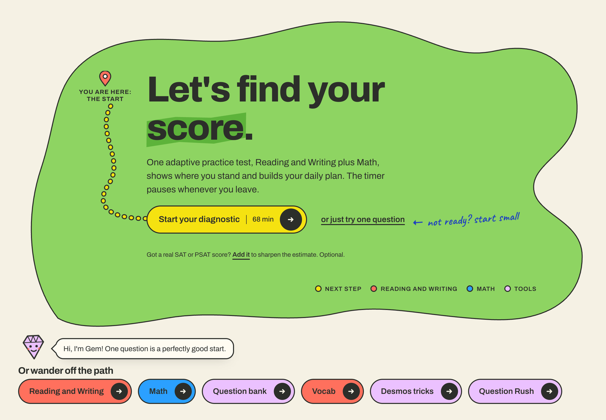
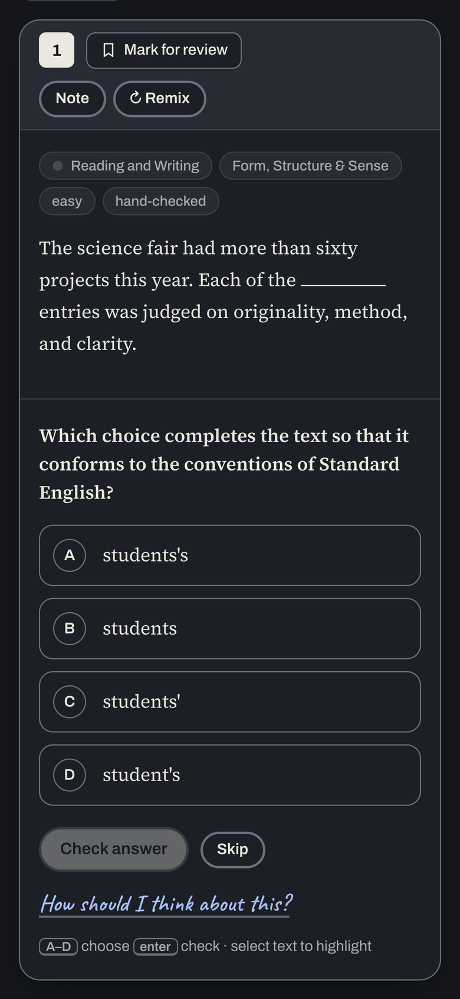
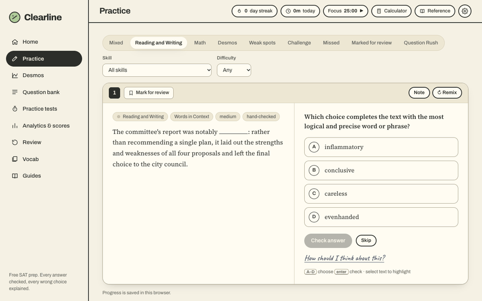

# Clearline SAT

**Free SAT prep where every answer is checked and every wrong choice is explained.**

[](https://clearline-sat.pages.dev)

No account, no paywall, no ads. Open the link and start practicing.

<p align="center">
  
</p>



<p align="center">
  
  <br><em>On a laptop in light mode, and on a phone in dark mode.</em>
</p>

## Features

### Desmos, step by step
- Every Math question has a "Desmos way" button that opens the live graphing calculator next to the question and walks through solving it one step at a time, with Gem, the mascot, saying what to type and why it works.
- Each step adds its expression to the graph, moves to the part that matters and highlights the key point. The answer stays hidden until the student answers or asks for it.
- "Why not Desmos?" questions show when solving by hand is faster. Every walkthrough's values are checked against real Desmos by the tests.

### Practice
- Reading and Writing and Math questions, filtered by skill, difficulty, weak spots, missed questions or marked-for-review.
- 90 hand-checked Reading and Writing questions and 13 classic Math questions, each with step-by-step solutions and a reason for every wrong choice.
- 28 Math generators that build fresh questions, compute their own answers, and make wrong choices from real student mistakes.
- Hints that underline the exact clue in the passage, and a "Remix" button for a new version of the same math problem.

<p align="center">
  
</p>

### Mock tests
- Full-length practice SAT modeled on the digital SAT (Bluebook): two modules per section, a break, a calculator and a reference sheet.
- Adaptive routing: how you do on module 1 decides whether module 2 is easier or harder.
- Extended time options (1.5x, 2x, untimed). The score is an honest estimate and is labeled as not official.

### Desmos lessons
- 18 short lessons on using the Desmos graphing calculator for SAT math, each with keystrokes, a "watch out" note and a live calculator pre-filled with the example.
- 75 original practice questions, with answer keys re-checked by the tests.

### Analytics
- Score estimate, accuracy by skill and difficulty, study-time heatmap, and a place to add real SAT or PSAT scores.
- A daily study plan built from your weak spots.
- A read-only progress report students can download and send to a teacher.

### Question Rush
- A timed round of 10, 20 or 30 questions at a relaxed, normal or fast pace. Right answers in a row build a combo, fast ones earn a star, and explanations wait until the end.

### Vocab
- Three ways to study the same deck for Words in Context: spaced-repetition **Flashcards**, a timed **Match** game (pair 6 words with 6 definitions and beat your best time), and **Learn** mode (pick the word that fits the sentence).
- Original definitions and example sentences.

### Mistakes notebook
- Review every missed question, tag why you missed it, write notes, and group questions into collections. Miss-pattern bars show what keeps tripping you up.

### Highlighter
- Select text in any passage to highlight it, just like Bluebook. Highlights are saved per question.

### Settings and backup
- Light, dark or system theme, timer settings and extended time.
- Download a backup file of your progress and restore it on any device. On iPhone, it can be added to the Home Screen like an app.

## How it's built

- **Plain HTML, CSS and JavaScript.** No frameworks, no build tools, no dependencies. The whole app is one page (`index.html`) plus a few script files in `assets/`.
- **Progress lives in the browser.** Everything a student does is saved in `localStorage` on their own device. Nothing is sent to a server.
- **Self-check tests.** `tests/` holds small Node scripts that check the question data: every answer key is valid, every wrong choice has an explanation, Desmos answers are recomputed from scratch, and the teacher report can't run scripts.
- **Hosted on Cloudflare Pages.** Every push to `main` runs `build.sh`, which copies only the public files into `dist/`, and Cloudflare publishes it.

More detail in [docs/ARCHITECTURE.md](docs/ARCHITECTURE.md).

## How I built it

I came up with the idea for Clearline because good SAT prep is often expensive, and free tools rarely explain *why* an answer is wrong. Before building anything, I researched what the top SAT prep sites and the official Bluebook app do well, and wrote down which features actually help students improve.

From there I chose and prioritized every feature, decided how each screen should look and feel, and gave design direction and feedback through many rounds of changes. I tested the site on real devices, my laptop and my phone, in light and dark mode, and fixed what felt wrong. Then I shipped it to the web and set up automatic deploys.

I used Claude Code as my coding tool: it wrote and tested the code under my direction.

What I learned:
- **Product decisions.** Deciding what *not* to build was as important as what to build. I kept the real SAT test format exact and put the fun in the voice, colors and feedback instead.
- **Directing an AI coding agent.** Clear, specific instructions and honest feedback got far better results than vague requests.
- **Testing.** Automated checks catch broken answer keys; real-device testing catches everything else.
- **Git.** Committing in small steps, writing clear messages, and cleaning up history before going public.
- **Deploying.** Hosting a static site on Cloudflare Pages, with security headers and caching rules.

## Roadmap

- **Accounts and sync** so progress follows a student across devices without a backup file.
- **More questions**, especially hand-written Math and harder Reading and Writing sets.
- **Teacher dashboard** so a teacher can see a whole class's progress live.

## Run it locally

You need Python 3 (already on most Macs) or any static file server.

```sh
git clone https://github.com/louisdott-a11y/clearline-sat.git
cd clearline-sat
python3 -m http.server 8000     # then open http://localhost:8000
```

Run the self-check tests (needs Node.js):

```sh
npm test
```

Deploy steps are in [docs/DEPLOY.md](docs/DEPLOY.md). The design system is documented in [DESIGN.md](DESIGN.md) and the product brief in [PRODUCT.md](PRODUCT.md).

## Credits

- Graphing calculator: [Desmos API](https://www.desmos.com/api).
- Fonts: [Archivo](https://fonts.google.com/specimen/Archivo), [Source Serif 4](https://fonts.google.com/specimen/Source+Serif+4) and [Caveat](https://fonts.google.com/specimen/Caveat), from Google Fonts.
- SAT and Bluebook are trademarks of the College Board, which is not affiliated with Clearline.

## License

[MIT](LICENSE)
